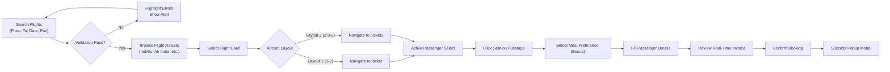
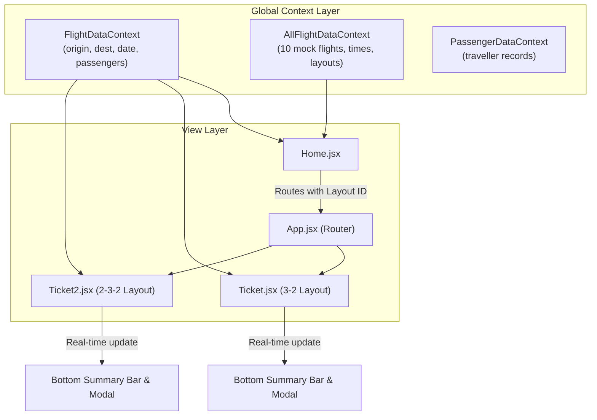
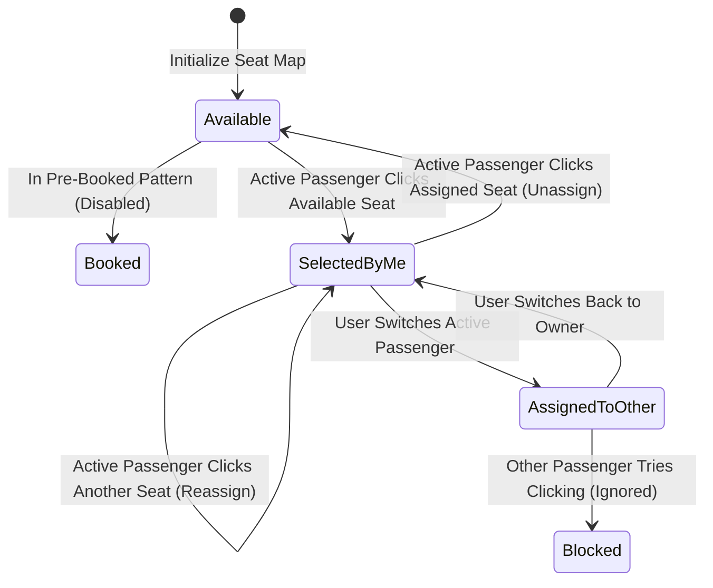
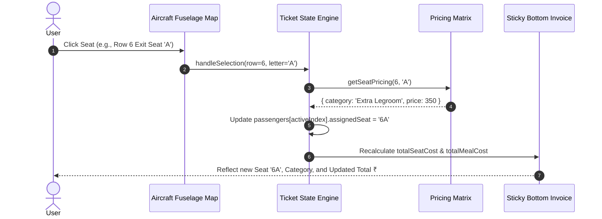

# Fly Way — Flight Seat Selection & Passenger Management System

[](https://react.dev/)
[](https://vitejs.dev/)
[](https://tailwindcss.com/)
[](https://reactrouter.com/)
[](LICENSE)

> A modern, responsive, and intuitive flight booking interface featuring realistic aircraft fuselage visualizers, dynamic dual-configuration seat maps (3–2 and 2–3–2 layouts), multi-passenger state-driven seat assignments, position-based tiered pricing calculations, and an in-flight meal selection engine.

---

## 📑 Table of Contents

- [Project Overview](#-project-overview)
- [What is New & Unique in This Project](#-what-is-new--unique-in-this-project)
- [Tech Stack & Dependencies](#️-tech-stack--dependencies)
- [Project Architecture & File Structure](#-project-architecture--file-structure)
- [Flowcharts & System Architecture](#-flowcharts--system-architecture)
  - [1. User Journey & Booking Flow](#1-user-journey--booking-flow)
  - [2. Component & Context State Flow](#2-component--context-state-flow)
  - [3. Seat Selection State Machine](#3-seat-selection-state-machine)
  - [4. Price & Billing Calculation Sequence](#4-price--billing-calculation-sequence)
- [Design System & UI/UX Standards](#-design-system--uiux-standards)
  - [Seat Status Legend](#seat-status-legend)
  - [Visual Aircraft Fuselage Styling](#visual-aircraft-fuselage-styling)
- [How to Use Fly Way (Walkthrough)](#-how-to-use-fly-way-walkthrough)
- [Setup & Installation Guide](#️-setup--installation-guide)
- [State Management & Assignment Logic Explanation](#-state-management--assignment-logic-explanation)
- [Edge Cases & Validation Matrix](#️-edge-cases--validation-matrix)
- [Deployment Guide (Vercel & GitHub Pages)](#-deployment-guide-vercel--github-pages)

---

## 🌟 Project Overview

**Fly Way** is a flight seat selection and passenger management web application developed as part of the **Frontend Developer Assessment**. It solves the real-world complexity of airline seat reservations by combining:

1. **Dual Aircraft Seating Configurations**: Supports both **3–2** (narrow-body/regional aircraft) and **2–3–2** (wide-body/twin-aisle aircraft) cabin layouts across 28 rows.
2. **Multi-Passenger Interactive Allocation**: Handles arbitrary passenger counts ($N \ge 1$), allowing seamless toggling between travellers, atomic seat assignments, and automatic conflict prevention.
3. **Tiered Seat Pricing Engine**: Dynamic seat valuations (Standard ₹0, Window/Premium, Aisle, and Exit Row Extra Legroom) with instant, reactive bill recalculations.
4. **In-Flight Meal Catering (Bonus Feature)**: Passengers can opt in for complimentary or premium meals, with live price tracking added to the final invoice.
5. **Realistic Aviation UI**: Complete with an aerodynamic fuselage silhouette, cockpit windshields, emergency exit indicators, and a floating glassmorphic checkout bar.

---

## What is New & Unique in This Project

Unlike standard form-based seat choosers, **Fly Way** introduces several cutting-edge technical and design implementations:

1. **Realistic Fuselage CSS Architecture**:
   - Custom polygon clipping (`polygon(15% 0, 85% 0, 100% 100%, 0 100%)`) creates a realistic aircraft nose cone.
   - Dual cockpit windshields, rounded aerodynamic fuselage contours, and distinct passenger aisle channels.
   - Physical exit row markers (`Exit Row [i]` at Rows 6 and 14) with regulatory legroom spacing indicators.

2. **Dual-Configuration Aircraft Support**:
   - **Configuration 1 (3–2)**: Single aisle layout with seats `[A, B, C]` and `[D, E]`.
   - **Configuration 2 (2–3–2)**: Twin aisle wide-body layout with groups `[A, B]`, `[D, E, F]`, and `[G, H]`.
   - Clean route separation (`/ticket` vs `/ticket2`) automatically determined by the chosen flight's aircraft model.

3. **Active-Passenger State Machine**:
   - Selecting a passenger visually highlights their active session across the passenger roster, seat map, and sticky bottom bar.
   - **One-Seat-Per-Passenger Guarantee**: Assigning a new seat automatically clears that passenger's previous seat without touching other passengers' allocations.
   - **Cross-Passenger Collision Prevention**: Seats reserved by Passenger A turn into non-selectable status for Passenger B, displaying the assigned owner index.

4. **Dynamic Tiered Pricing & Position Overrides**:
   - Category-based pricing algorithm that evaluates row number and column position:
     - **Extra Legroom** (Exit rows 6 & 14): Premium surcharge.
     - **Window Seats** (A, E or A, H): Scenic view surcharge.
     - **Aisle Seats** (C, D or B, D, F, G): Quick egress convenience fee.
     - **Standard / Middle Seats**: Baseline / Complimentary (₹0).
   - Instant calculation of seat charges, meal charges, and combined totals without page refreshes.

5. **In-Flight Meal Selection (Bonus Requirement)**:
   - Interactive meal opt-in per passenger with four distinct menu items (Vegetarian complimentary, Fruit & Snack, Paneer Thali, Chicken Meal).
   - Independent price aggregation updating the passenger invoice live.

6. **Defensive Form & Date Validation**:
   - HTML5 date picker with dynamic `minDate` lock (prevents selecting past dates).
   - Strict validation preventing identical departure and arrival stations (e.g., Kolkata to Kolkata).
   - Real-time feedback and highlighted input borders on validation failures.

---

## Tech Stack & Dependencies

| Category | Technology / Package | Purpose |
|---|---|---|
| **Core Framework** | [React 19.3.1](https://react.dev/) | Component architecture, modern React hooks (`useState`, `useEffect`, `useContext`, `useMemo`) |
| **Bundler & Dev Server** | [Vite 8.3.6](https://vitejs.dev/) | Lightning-fast HMR, optimized tree-shaking, ES modules |
| **Styling Engine** | [Tailwind CSS v4.3.5](https://tailwindcss.com/) | Modern utility-first CSS, custom animations, responsive flex/grid layouts |
| **Routing** | [React Router DOM v7.18.5](https://reactrouter.com/) | Client-side routing (`/`, `/ticket`, `/ticket2`) with smooth navigation |
| **Icons & Typography** | [FontAwesome SVG Icons](https://fontawesome.com/) & Varela Round | Accessible, crisp vector icons (`faPlaneDeparture`, `faPlaneArrival`, `faCalendarDay`, `faUser`) |
| **State Management** | React Context API | Global providers for flight parameters (`FlightData`), inventory (`AllFlightData`), and passenger states |
| **Code Quality** | ESLint 9 + React Hooks Plugin | Strict linting rules and code formatting |

---

## Project Architecture & File Structure

```text
fly-way/
├── README.md                      # Comprehensive project documentation
├── LICENSE                        # MIT Open Source License
└── frontend/                      # React + Vite application
    ├── index.html                 # Single page application entry HTML
    ├── package.json               # Dependencies, scripts, and metadata
    ├── vite.config.js             # Vite configuration with Tailwind CSS plugin
    ├── eslint.config.js           # ESLint configuration
    ├── public/                    # Static airline branding & destination images
    │   ├── Air India.jpg          # Airline brand assets
    │   ├── Akasa Air.jpg
    │   ├── IndiGo.jpg
    │   ├── SpiceJet.jpg
    │   ├── Vistara.jpg
    │   ├── image1.png–image7.png  # Destination & adventure deal images
    │   ├── app store.png          # App marketplace download badges
    │   └── google play.png
    └── src/
        ├── main.jsx               # Application root mounting Context Providers
        ├── App.jsx                # Router configuration & base layout shell
        ├── App.css                # Component-level styles
        ├── index.css              # Global styles, Tailwind imports, scrollbar utilities
        ├── assets/                # Vector graphics (world-map.svg, hero graphics)
        ├── contexts/              # React Context Providers (State Management)
        │   ├── FlightData.jsx     # Active search parameters (origin, dest, date, count)
        │   ├── allFlightData.jsx  # Mock database of 10 domestic flights with layout metadata
        │   └── PassengerData.jsx  # Global passenger state registry
        └── components/            # Reusable UI Components
            ├── Navbar.jsx         # Sticky header with brand logo & navigation links
            ├── Home.jsx           # Flight search form & filtered flight result cards
            ├── Others.jsx         # Explore flight deals & curated destination stays
            ├── Footer.jsx         # Footer with support links and social icons
            ├── Ticket.jsx         # Seat selection for Layout 1 (3–2 Configuration)
            └── Ticket2.jsx        # Seat selection for Layout 2 (2–3–2 Configuration)
```

---

## Flowcharts & System Architecture

### 1. User Journey & Booking Flow



---

### 2. Component & Context State Flow



---

### 3. Seat Selection State Machine



---

### 4. Price & Billing Calculation Sequence



---

## Design System & UI/UX Standards

Fly Way employs a cohesive modern design language adhering to accessibility, contrast requirements, and visual hierarchy.

### Seat Status Legend

| Status | Color Code | Tailwind Class | Visual Description |
|---|---|---|---|
| **Available (Standard)** | `#423EE1` | `bg-[#423EE1]` | Primary Indigo; selectable by active traveller |
| **Available (Window/Premium)** | `#35C9AE` | `bg-[#35C9AE]` | Teal accent; premium window view |
| **Available (Extra Legroom)** | `#E89D45` | `bg-[#E89D45]` | Amber/Orange; exit rows and bulkhead |
| **Already Booked** | `#E9E8FC` | `bg-[#E9E8FC]` | Light lavender-gray; muted, cursor `not-allowed` |
| **Selected by Active Passenger** | `#ED5D7C` | `bg-[#ED5D7C]` | Vibrant Coral Red with `✓` checkmark |
| **Assigned to Another Passenger** | `#F4A261` | `bg-[#F4A261]` | Warm Amber showing passenger number badge |

### Visual Aircraft Fuselage Styling

- **Nose Cone**: Crafted using CSS clipping `[clip-path:polygon(15%_0,85%_0,100%_100%,0_100%)]`.
- **Cockpit Windshields**: Dual symetric cockpit glass panels in `#D7D8FF`.
- **Aisles**: Explicit spacer channels between seat groupings (32px central aisle in 3–2, dual aisles in 2–3–2).
- **Exit Rows**: Row 6 and Row 14 feature distinct `i Exit row` badges with regulatory legroom spacing.
- **Glassmorphic Floating Invoice**: High-opacity white background (`bg-white/90 backdrop-blur-[5px]`) with top elevation shadow (`shadow-[0_-4px_20px_rgba(0,0,0,0.05)]`).

---

## How to Use Fly Way (Walkthrough)

### Step 1: Flight Search
1. Open the home page (`http://localhost:5173/`).
2. Enter your **Departure City** (e.g., `Kolkata`, `Mumbai`, `Bengaluru`).
3. Enter your **Destination City** (e.g., `Delhi`, `Goa`, `Chennai`).
4. Pick a **Departure Date** (past dates are disabled).
5. Specify the **Number of Passengers** ($1$ to $9+$).
6. Click **Search**.

### Step 2: Choose a Flight
- A list of domestic flights will appear (IndiGo, Air India, Vistara, SpiceJet, Akasa Air).
- Each card highlights the duration, departure/arrival times, stops (Non-Stop, 1 Stop, 2 Stops), base ticket fare, and **Cabin Layout** (3–2 or 2–3–2).
- Click on any flight card to launch the Aircraft Seat Selection interface.

### Step 3: Switch & Assign Passengers
- On the right panel, you will see a list of traveller cards (`Passenger 1`, `Passenger 2`, etc.).
- Click on any passenger card to make them the **Active Passenger** (indicated by an active border and pulse indicator).
- Tap an available seat on the visual aircraft body on the left.
- The seat is instantly assigned to that passenger and marked in coral red (`✓`).
- To change seats, simply click another available seat. To remove a seat, click the assigned seat again or press **✕ Remove**.

### Step 4: In-Flight Meal Selection (Optional Bonus)
- Under each passenger card, select whether the traveller wants an in-flight meal.
- If **Yes**, choose from the available culinary options:
  - *Vegetarian Meal* (Complimentary — ₹0)
  - *Fruit & Light Snack* (₹120)
  - *Paneer Meal* (₹180)
  - *Chicken Meal* (₹250)
- The meal charge is immediately added to that passenger's subtotal.

### Step 5: Fill Passenger Contact Information
- Provide Full Name, Age, Gender, Email Address, and Phone Number.
- Fill in the Emergency Contact details for safety compliance.

### Step 6: Review & Confirm Booking
- Check the floating bottom bar displaying each traveller's assigned seat, meal preference, and live cumulative bill.
- Click **Save and close** to return to search, or click **Confirm booking** to open the Booking Confirmation Modal.

---

## ⚙️ Setup & Installation Guide

### Prerequisites
Make sure you have the following installed on your operating system:
- **Node.js** (v18.0.0 or higher recommended)
- **npm** (v9.0.0 or higher) or **yarn** / **pnpm**

### Step-by-Step Installation

1. **Clone the Repository**:
   ```bash
   git clone https://github.com/your-username/fly-way.git
   cd fly-way
   ```

2. **Navigate to the Frontend Directory**:
   ```bash
   cd frontend
   ```

3. **Install Dependencies**:
   ```bash
   npm install
   ```

4. **Start the Development Server**:
   ```bash
   npm run dev
   ```
   The application will start with Hot Module Replacement (HMR) at:
   `http://localhost:5173`

5. **Build for Production**:
   ```bash
   npm run build
   ```
   The compiled, minified bundle will be output to `frontend/dist/`.

6. **Preview Production Build**:
   ```bash
   npm run preview
   ```

7. **Run Linter**:
   ```bash
   npm run lint
   ```

---

## State Management & Assignment Logic Explanation

### 1. Single Source of Truth
The passenger record array in `Ticket.jsx` / `Ticket2.jsx` is the primary source of truth:
```javascript
const createEmptyPassenger = () => ({
  name: "",
  age: "",
  gender: "",
  email: "",
  phone: "",
  emergencyName: "",
  emergencyPhone: "",
  assignedSeat: null,       // e.g. "6A"
  mealRequired: null,       // true | false | null
  selectedMeal: ""          // e.g. "paneer-meal"
});
```

### 2. Assignment Invariants & Conflict Avoidance
- **No Duplicate Seats**: When clicking seat $S$, the system scans `passengers.findIndex(p => p.assignedSeat === S)`. If assigned to another traveller, the action is blocked.
- **Seat Replacement**: If active passenger $P$ already holds seat $S_1$ and selects $S_2$, $S_1$ is automatically released and $S_2$ assigned in a single atomic update.
- **Toggle Deselection**: If passenger $P$ clicks their own currently assigned seat $S_1$, `assignedSeat` is reset to `null`.
- **Stable References**: Switching between passengers retains all historical seat choices.

### 3. Immediate Reactive Total Computation
Seat and meal totals are derived reactively via array reductions rather than stored in redundant state:
$$\text{Total Booking Cost} = \sum_{i=1}^{N} \text{SeatPrice}(P_i) + \sum_{i=1}^{N} \text{MealPrice}(P_i)$$
Any change in seat tier or meal choice updates the bottom bar instantaneously with zero latency.

---

## Edge Cases & Validation Matrix

| Edge Case Scenario | System Response & Resolution |
|---|---|
| **Departure = Arrival** | Displays warning alert: *"Departure and arrival locations cannot be the same"* and cancels submission. |
| **Past Date Selection** | Date input sets `min={minDate}` preventing selection of past dates in calendar picker. |
| **Zero or Negative Passengers** | Search form sets `min="1"` and `Math.max(1, passengerCount)` fallback. |
| **Multiple Passengers Claiming One Seat** | Disabled pointer events and condition check prevents overriding another passenger's seat. |
| **Passenger Count Adjusted After Search** | Dynamic array resizing ensures existing passenger data and assigned seats are preserved up to the new count. |
| **Missing Flight Data Direct URL Visit** | Fallback defaults ensure graceful rendering with sample cities and standard passenger count without crashes. |
| **Invalid Image URL for Airline Logo** | `onError` handler automatically falls back gracefully to airline text badge. |

---

## Deployment Guide (Vercel & GitHub Pages)

### Deploying to Vercel (Recommended)

1. Push your repository to GitHub.
2. Sign in to [Vercel](https://vercel.com/) and click **Add New Project**.
3. Import your `fly-way` repository.
4. Set the **Root Directory** to `frontend`.
5. Configure the build settings:
   - **Framework Preset**: `Vite`
   - **Build Command**: `npm run build`
   - **Output Directory**: `dist`
6. Click **Deploy**. Vercel will provide an SSL-secured production URL.

### Single Page Application (SPA) Routing on Vercel
To ensure direct links to `/ticket` and `/ticket2` work without 404 errors, add a `vercel.json` file inside `frontend/`:
```json
{
  "rewrites": [
    { "source": "/(.*)", "destination": "/index.html" }
  ]
}
```

---

## 📄 License

This project is licensed under the [MIT License](LICENSE) — feel free to use and adapt this project for educational and professional purposes.

---


